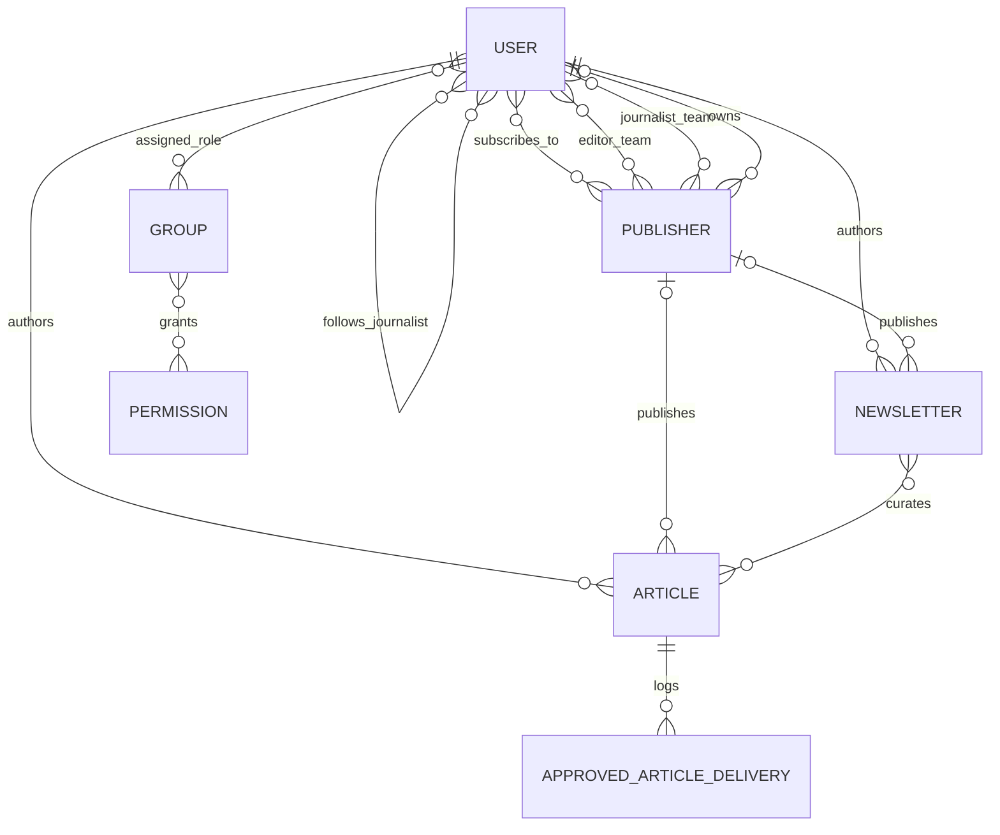

# News Application: requirements and design

This document records the implemented design and the requirements reviewed on
22 September 2026. It was added during the requirements review; it is not a claim
that a separate design document existed before development.

## Functional requirements

| ID | Requirement | Implementation / acceptance condition |
|---|---|---|
| FR1 | Register and authenticate users | Public signup, login/logout, token issuance; no public staff or superuser grants. |
| FR2 | Assign reader, journalist and editor roles and groups | User-save signal synchronizes role groups and permissions. A publisher role additionally supports team management. |
| FR3 | Readers subscribe to publishers and journalists | Both subscriptions are many-to-many; non-readers cannot add subscriptions. |
| FR4 | Journalists author independent or publisher articles | Author is the current journalist; publisher is optional and must include the author in its journalist team. |
| FR5 | Editors review and approve drafts | Review queue and POST approval actions require the editor role. |
| FR6 | Enforce content management permissions | Editors may update/delete content; journalists may update/delete their own content; readers and publishers cannot mutate it. Checks use the current role even for historical authors. |
| FR7 | Expose published article APIs | GET /api/articles/ returns approved articles; reader access is also limited by subscriptions. Detail, POST, PUT/PATCH and DELETE routes are available. |
| FR8 | Provide a subscribed feed and separate drafts | /api/articles/subscribed/ is reader-only. /api/articles/drafts/ is for editors and journalists, with journalists limited to their own drafts. |
| FR9 | Curate newsletters | Journalists and editors create newsletters from approved articles; readers view subscribed newsletters. Readers see only approved constituent articles from sources they follow. |
| FR10 | Notify subscribers on approval | Approval views call email and local API services; duplicate recipient addresses are deduplicated. A failed HTTP integration is logged and reported without undoing approval. |
| FR11 | Re-review journalist revisions | Changes to title, content or publisher withdraw approval; unchanged submissions keep their status. Editor changes retain editorial approval. |
| FR12 | Manage publisher teams | A publisher account manages only its owned publisher's active editors and journalists. |
| FR13 | Persist data in MariaDB | Django MySQL backend connects to MariaDB; versioned migrations recreate the schema. |

The brief describes the general feed as “all approved articles” while also
requiring readers to access only subscribed content. This implementation gives
newsroom staff the approved feed and keeps reader subscription restrictions on
both general and subscribed feeds. Drafts have a separate endpoint. Browser
newsroom dashboards continue to show permitted drafts for editing.

The brief permits newsletters to be created by journalists and editors, although
its later group-permission list gives editors only view/change/delete. The UI and
API allow editor newsletter creation and otherwise follow the listed permissions.

## Non-functional requirements

| Area | Requirement and verification |
|---|---|
| Access control | Authenticate API requests; enforce role and ownership checks server-side; exercise allowed and denied requests in automated tests. |
| Privacy | Do not expose drafts or unsubscribed article excerpts through newsletters. Never package .env, database files or real account data. |
| Integrity | Use foreign keys, join tables and uniqueness constraints; validate journalist/publisher membership and approved newsletter selections. |
| Usability | Provide role-specific navigation, labeled forms, status badges, error messages and confirmation pages for deletion. |
| Responsive design | Shared templates and responsive stylesheet support different screen sizes; manually check mobile layout before public release. |
| Maintainability | Separate models, forms, serializers, permissions, services and templates; keep database changes in migrations. |
| Reliability | Use a bounded three-second integration timeout and logged failures; regression tests cover failure handling. |
| Portability | Document Python dependencies, environment variables, setup commands and migration steps. Test against SQLite and MariaDB. |

Development limitations: console email demonstrates the notification flow but
requires SMTP configuration for real mailbox delivery. DEBUG and permissive
local host settings are for coursework. Production deployment requires hardened
settings, credential handling, password policy and reliable notification retries.
No performance or accessibility certification is claimed.

## UI/UX structure and wireframes

These text wireframes describe the current interface rather than a visual redesign.

```text
Login / signup
+---------------------------------------------------+
| The Daily Brief                                   |
| Username [________________]                       |
| Password [________________]                       |
| [Sign in]      Create an account                   |
| Signup: email, role, optional publisher name       |
+---------------------------------------------------+

Role dashboard
+---------------------------------------------------+
| Brand | Articles | Newsletters | Dashboard | Exit  |
| [Role] workspace                                  |
| [Article count] [Role-specific counts]             |
| Primary action:                                   |
| Reader: subscriptions / Journalist: write article  |
| Editor: review queue / Publisher: manage team      |
| Recent content cards                              |
+---------------------------------------------------+

Editor queue / article review
+---------------------------------------------------+
| Pending review                                    |
| Title + author + draft status                     |
| Open article -> read full content                 |
| [Edit] [Approve & notify] [Delete confirmation]     |
+---------------------------------------------------+

Reader subscriptions and feed
+---------------------------------------------------+
| Publishers [ ] [ ]    Journalists [ ] [ ]          |
| [Save subscriptions]                              |
| Approved subscribed articles -> article detail    |
| Subscribed newsletters -> permitted article cards |
+---------------------------------------------------+
```

Deletion requires a confirmation page and POST. Approval is POST-only.
Authentication redirects browser visitors to login; forbidden API requests return
appropriate errors. Article detail shows published or awaiting-review status.

## Database relationships



- **User:** Django AbstractUser fields, role, and two subscription relationships.
  Reverse `articles` and `newsletters` relations identify authored content;
  filtering `publisher__isnull=True` identifies independent content.
- **Article:** title, content, author FK, optional publisher FK, creation timestamp,
  approval flag.
- **Publisher:** unique name, description, optional owner FK, separate editor and
  journalist many-to-many teams.
- **Newsletter:** title, description, creation timestamp, author FK, optional
  publisher FK and article many-to-many collection.
- **ApprovedArticleDelivery:** article FK and receipt timestamp; the receiver
  avoids repeated logs during sequential duplicate deliveries.

### Normalization rationale

1. **First normal form:** each field stores one value. Lists of subscriptions,
   team members and newsletter articles use join tables rather than comma-separated
   values or repeated numbered columns.
2. **Second normal form:** entity attributes depend on their entity primary key.
   Django's many-to-many join rows represent one relationship and enforce unique
   pairs, without duplicating article or publisher descriptions.
3. **Third normal form:** user identity and publisher descriptions live in their
   own tables. Articles and newsletters refer to those entities by foreign key;
   changing a publisher's name does not require rewriting each article.

Role groups mirror the role field to integrate Django permissions; the save
signal maintains that intentional duplication. Many-to-many fields cannot store
SQL NULL, so the brief's “None” for inapplicable subscriptions is represented by
an empty relation. Role changes clear subscriptions while preserving historical
authorship; former journalists do not retain editing rights as readers.

## Validation and traceability

The original tests in `news/tests.py` and `tests.py` cover onboarding, team
ownership, role access, subscriptions and approval notifications. The
`RequirementsRegressionTests` class adds full editor PUT, draft-feed separation,
reapproval, newsletter visibility and CRUD, former-author permissions, token
issuance and integration failure/receiver tests. See `VALIDATION.md` for actual
execution results and database verification.
